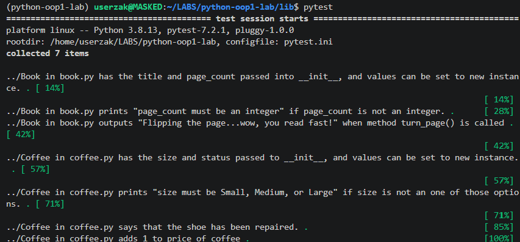

# Object Oriented Programming Lab - Bookstore
 
## Description
 
This project models a simple bookstore using Object-Oriented Programming in
Python. It defines two classes:
 
- **`Book`** (`lib/book.py`) — represents a book available to read, with a
  title and page count. Includes a `turn_page()` method and validation
  ensuring `page_count` is always an integer.
- **`Coffee`** (`lib/coffee.py`) — represents a coffee sold in the store,
  with a size and price. Includes a `tip()` method that increases the price,
  and validation ensuring `size` is always `"Small"`, `"Medium"`, or
  `"Large"`.
Both classes use Python properties (`@property` / `@<attr>.setter`) to
validate their data whenever it is set — either at creation or later, when
an attribute is reassigned.
 
## Installation
 
1. Fork this repository to your own GitHub account.
2. Clone your fork locally:
```console
   git clone <your-fork-url>
   cd python-oop1-lab
```
3. Install dependencies:
```console
   pipenv install
```
4. Enter the virtual environment:
```console
   pipenv shell
```
 
## Usage
 
### Book
 
```python
from lib.book import Book
 
book = Book("Dune", 412)
print(book.title)          # Dune
print(book.page_count)     # 412
book.turn_page()            # Flipping the page...wow, you read fast!
 
book.page_count = "many"    # page_count must be an integer
```
 
### Coffee
 
```python
from lib.coffee import Coffee
 
coffee = Coffee("Medium", 4.50)
print(coffee.size)          # Medium
coffee.tip()                 # This coffee is great, here's a tip!
print(coffee.price)         # 5.50
 
coffee.size = "Extra Large"  # size must be Small, Medium, or Large
```
 
## Tests
 
This project is test-driven, using `pytest`. Run all tests from the project
root:
 
```console
pytest
```
 
Or run each class's tests individually:
 
```console
pytest -x testing/book_test.py
pytest -x testing/coffee_test.py
```
 
The `-x` flag stops the run at the first failure — useful while
test-driving new code.
 
**All 7 tests passing:**
 
![Passing tests]

 
## Project Status
 
Complete — both `Book` and `Coffee` classes are implemented, documented,
and pass all provided tests.
 
## Authors and Acknowledgment
 
Lab scenario and starter test suite provided by Moringa School / Flatiron
curriculum. Implementation by [your name/GitHub handle here].