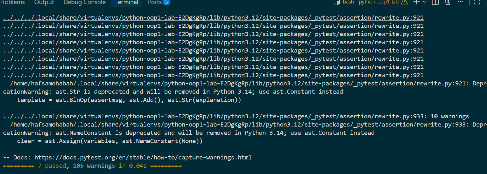

# Bookstore OOP Lab

## Overview

This project demonstrates object-oriented programming in Python by modeling two objects used in a bookstore: books and coffee.

## Features

### Book

- Stores a book's title and page count.
- Checks that the page count is an integer.
- Prints an error message if an invalid page count is assigned.
- Provides a `turn_page()` method that prints a page-turning message.

### Coffee

- Stores the coffee's size and price.
- Accepts the sizes `Small`, `Medium`, and `Large`.
- Prints an error message if an invalid size is assigned.
- Provides a `tip()` method that prints a message and increases the price by 1.

## Project Structure

- `lib/book.py` — Book class.
- `lib/coffee.py` — Coffee class.
- `lib/testing/book_test.py` — Tests for the Book class.
- `lib/testing/coffee_test.py` — Tests for the Coffee class.

## Setup

This project uses Pipenv to manage its Python environment.

```bash
pipenv install
```

Run the tests for both classes:

```bash
pipenv run pytest
```

## Testing

The test suite currently passes all 7 tests.

## Technologies

- Python
- Object-oriented programming
- Pytest
- Pipenv
- Git and GitHub

## Screenshot

Add a screenshot of the completed project and passing tests here.


